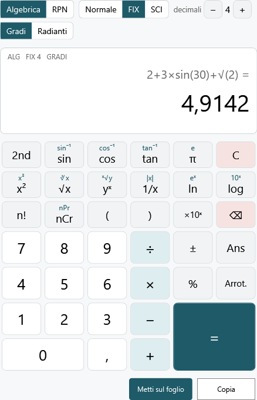
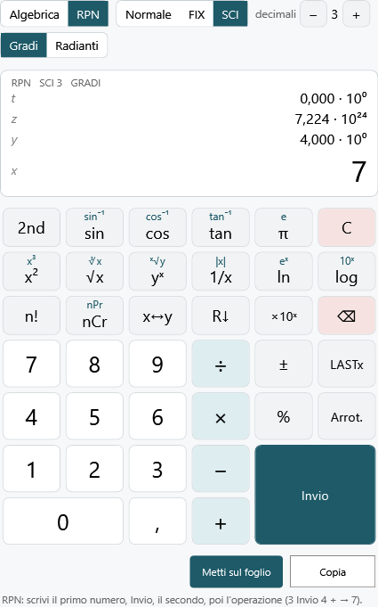

# La calcolatrice

Ardesia ha una **calcolatrice scientifica** sua, pensata per la LIM: tasti grandi, numeri scritti all'italiana, decimali fissi o notazione scientifica a scelta, e il risultato che si mette sul foglio con un tocco. Si apre col pulsante **Calcolatrice** nella scheda **Inserisci** (o nella barra semplificata, accanto a GeoGebra).

La finestra resta sopra Ardesia mentre scrivi sul foglio. Si sposta e **si ingrandisce** trascinandone il bordo: tasti e display crescono insieme, così sulla LIM la si vede anche dall'ultimo banco. Ardesia ricorda dove l'hai messa e le scelte fatte (modalità, formato, decimali, gradi o radianti).

## I pulsanti in alto

- **Algebrica / RPN**: come si scrivono i calcoli (vedi sotto).
- **Normale / FIX / SCI**: come si mostrano i numeri.
  - **Normale**: tutte le cifre che servono, fino a 12; i numeri enormi o minuscoli passano da soli alla notazione scientifica.
  - **FIX**: sempre lo stesso numero di **decimali**, arrotondato. Con 2 decimali 2,675 diventa **2,68** (l'arrotondamento è quello del quaderno, non quello «binario» di molte calcolatrici che darebbe 2,67).
  - **SCI**: **notazione scientifica**, per esempio 1,235 · 10⁴, con il numero di decimali scelto nella mantissa.
- **decimali − / +**: da 0 a 9, per FIX e SCI.
- **Gradi / Radianti**: per seno, coseno, tangente e le loro inverse. In gradi sen 180° fa esattamente 0 e tan 90° dà un messaggio, non un numero assurdo.

In FIX un numero che con quei decimali sembrerebbe zero (per esempio 0,00001 con 2 decimali) compare in notazione scientifica, per non far credere che sia 0. I numeri da 10 000 in su sono scritti a gruppi di tre cifre (12 345 678).

Il tasto **Arrot.** arrotonda *davvero* il risultato a come lo vedi: con FIX 2, 2 ÷ 3 = 0,67 e poi Arrot. × 3 = 2,01.

## Modalità algebrica

Si scrive il calcolo intero, come sul quaderno, e **=** lo esegue. Sul display in piccolo resta il calcolo, in grande il risultato.

- Valgono le **precedenze**: 2 + 3 × 4 = 14, e −2² = −4.
- Il **per si può sottintendere**: 2π, 3(1 + 2), 2 sin(30).
- Le **parentesi** lasciate aperte si chiudono da sole: `√(2` va bene.
- Dopo **=**, un operatore continua dal risultato (**Ans**): 2 + 3 = × 2 = fa 10. Una cifra invece comincia un calcolo nuovo.
- **⌫** dopo **=** riapre il calcolo per correggerlo; **C** cancella tutto.
- **±** cambia il segno del numero che stai scrivendo; **×10ˣ** scrive l'esponente: 1,5 ×10ˣ 3 è 1500 (premi ± dopo ×10ˣ per un esponente negativo).
- **nCr** e **nPr** si scrivono fra i due numeri: 10 nCr 3 = 120.
- **ˣ√y** si scrive fra l'indice e il numero: 3 ˣ√y 8 = 2.

## Modalità RPN

La **notazione polacca inversa** delle calcolatrici HP: prima i numeri, poi l'operazione. Per 3 + 4 si preme `3` **Invio** `4` **+**. Non servono parentesi: (2 + 3) × 4 è `2` Invio `3` + `4` ×.

Sul display ci sono i quattro registri della **pila**: **x** (in grande, il numero su cui si lavora), **y**, **z**, **t**.

- **Invio** copia x in y (e fa salire la pila); il numero che scrivi dopo prende il posto di x.
- Le operazioni con due numeri usano **y** e **x** e fanno scendere la pila.
- **x↔y** scambia x e y; **R↓** fa ruotare la pila verso il basso; **LASTx** richiama la x di prima dell'ultima operazione.
- **⌫** cancella l'ultima cifra o, se non stai scrivendo, azzera x; **C** azzera tutta la pila.
- **%** calcola la percentuale di y: 200 Invio 15 % dà 30 (e 200 resta in y).

## Il tasto 2nd

Molti tasti hanno una **seconda funzione**, scritta in piccolo color petrolio sopra il tasto: sin⁻¹, cos⁻¹, tan⁻¹, e, x³, ∛x, ˣ√y, |x|, eˣ, 10ˣ, nPr. Si usa premendo prima **2nd** (che si colora) e poi il tasto; dopo un tasto 2nd si spegne da solo.

## Mettere il risultato sul foglio

- **Metti sul foglio** scrive il risultato in una casella di testo nella parte visibile della pagina: in algebrica con il calcolo («2+3×4 = 14»), in RPN solo il numero. Più risultati di fila vanno uno sotto l'altro.
- **Copia** lo mette negli appunti, da incollare dove vuoi.

## Dalla tastiera

Quando la calcolatrice è la finestra attiva funziona anche la tastiera: cifre, virgola (o punto), `+ - * /`, `^` per la potenza, parentesi, `!`, `%`, `e` per ×10ˣ, **Invio** (=), **Backspace** (⌫), **Esc** (C).
