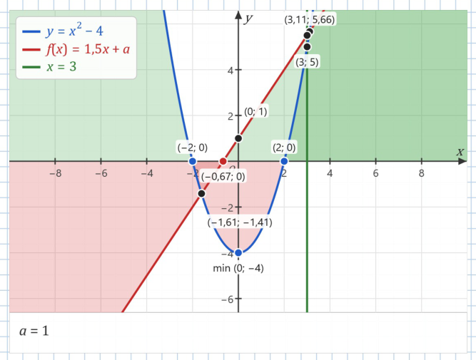
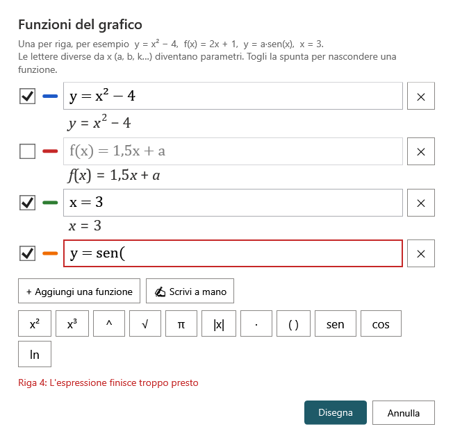
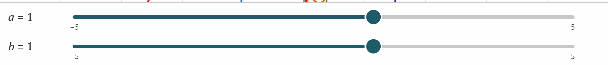

# Il grafico di funzione di Ardesia

Il pulsante **Grafico** disegna direttamente sul foglio il grafico di una o più funzioni scritte come sul quaderno: `y = x² − 4`, `f(x) = 1,5x + a`, `y = sen 2x`, `x = 3`.

Perché usarlo invece di GeoGebra:

- **funziona senza internet** e si apre all'istante;
- è **disegnato da Ardesia** sul foglio: resta nitido a ogni zoom e nel PDF, sta **sotto l'inchiostro** (ci si scrive sopra con le penne), si sposta e si ridimensiona come un'immagine;
- mostra su richiesta **zeri, intersezioni, massimi e minimi, derivata, segno**, con le coordinate scritte all'italiana: `(1,5; −2)`;
- le lettere diverse da `x` diventano **parametri con un cursore** da trascinare.

Per la geometria, le costruzioni e i casi più avanzati resta [GeoGebra](GeoGebra.md).

> **Attenzione ai PC con Ardesia vecchia.** Le versioni **0.3.2 e precedenti** cancellano i grafici quando salvano il blocco appunti. Aggiorna Ardesia su tutti i PC dove apri i blocchi con i grafici (vedi [Installazione](Installazione.md#aggiornare-a-una-versione-nuova)).

## Creare un grafico

Ci sono tre modi.

**1. Da una casella di testo** (il più comodo con la tastiera)

1. Scrivi le funzioni in una [casella di testo](Testo-immagini-e-appunti.md#caselle-di-testo), **una per riga**.
2. Seleziona la casella (strumento **Seleziona**, tocca il testo) o lascia il cursore dentro la casella.
3. Premi **Grafico** (scheda *Inserisci* o barra semplificata), oppure dal menu contestuale della casella **Disegna il grafico di questa funzione**.

Il grafico compare **accanto al testo**, che resta com'è.

**2. Scrivendo a mano sul foglio** – scrivi la funzione con la penna, prendila col lazo e premi **Grafico**. Vedi [Scrivere a mano le funzioni](Scrittura-a-mano-delle-funzioni.md).

**3. Senza niente di selezionato** – premi **Grafico**: si apre la finestrella **Funzioni del grafico** dove scrivere le funzioni (anche [a mano](Scrittura-a-mano-delle-funzioni.md#nella-finestrella--scrivi-a-mano)). Premi **Disegna**.

Il grafico nuovo compare già selezionato, con lo strumento **Seleziona** attivo.

## Come si scrivono le funzioni

Una funzione per riga, nelle forme:

| Forma | Esempi |
|---|---|
| `y = …` | `y = x² − 4` · `y = 2x + 1` · `y = (x + 1)/(x − 2)` |
| `f(x) = …` (anche g, h…) | `f(x) = 1,5x + a` · `g(x) = √(x + 4)` |
| solo l'espressione (sottinteso `y =`) | `x³ − 3x` |
| retta verticale `x = numero` | `x = 3` |

Che cosa capisce Ardesia:

- **moltiplicazione sottintesa**, come sul quaderno: `2x`, `ax`, `3(x + 1)`, `(x + 1)(x − 1)`, `2πx`; si può scrivere anche `·` o `*`;
- **potenze**: `x²`, `x³` oppure `x^4`, `2^(−x)`, `e^(x/2)`;
- **frazioni** con `/`: `1/x`, `(x + 1)/(x − 1)`;
- **virgola decimale**: `1,5x` (va bene anche il punto);
- **radice**: `√x`, `√(x + 4)`; **valore assoluto**: `|x − 1|`;
- **funzioni** (anche **senza parentesi**: `sen 2x`): `sen` (o `sin`), `cos`, `tg` (o `tan`), `cotg`, `arcsen`, `arccos`, `arctg`, `ln`, `log` (in base 10), `exp`, `abs`, `sgn`; anche `sen² x`;
- **costanti**: `π` (o `pi`) ed `e`;
- **parametri**: qualsiasi altra lettera (`a`, `b`, `k`, `m`…) diventa un parametro con il suo cursore.

Se una riga non va, la finestrella la segna **in rosso** e spiega che cosa manca, in italiano: «Manca una parentesi chiusa», «L'espressione finisce troppo presto», «Non conosco “sinn”»… Le altre righe si disegnano lo stesso.

## La finestrella «Funzioni del grafico»

Si apre con un **doppio clic** sul grafico, con lo strumento **Seleziona**, oppure dal menu del grafico (*Funzioni del grafico…*), oppure premendo **Grafico** con il grafico selezionato.

> Sulla LIM, se il doppio tocco non apre la finestrella, tieni premuto sul grafico e scegli *Funzioni del grafico…* dal menu.

- Ogni funzione ha la sua **riga**: la **casella da spuntare** mostra o nasconde la funzione nel grafico, il **trattino colorato** è il suo colore, **✕** la toglie.
- Sotto ogni riga compare la **formula composta** (frazioni, esponenti, radici), per controllare di aver scritto giusto.
- **+ Aggiungi una funzione** aggiunge una riga; anche **Invio** alla fine di una riga ne crea una nuova. Incollando un testo di più righe, ogni riga diventa una funzione.
- I **tasti** `x²` `x³` `^` `√` `π` `|x|` `·` `( )` `sen` `cos` `ln` scrivono i simboli più scomodi da trovare sulla tastiera della LIM.
- **✍ Scrivi a mano** apre una striscia dove scrivere la funzione con la penna: vedi [Scrivere a mano le funzioni](Scrittura-a-mano-delle-funzioni.md).
- In fondo: «✓ Tutto a posto» oppure l'elenco degli errori; **Disegna** applica, **Annulla** lascia tutto com'era.

Una funzione **nascosta** non si disegna e non compare nella legenda, ma resta nella finestrella (e i suoi parametri restano).

## Che cosa mostra il grafico

- **Assi** con le frecce, le etichette `x` e `y`, l'origine `O` e i numeri sulle tacche (passo 1, 2, 5, 10… secondo lo zoom).
- Le **curve**, ognuna col suo colore. Agli asintoti (`1/x`, `tg x`) la curva si interrompe, senza la falsa riga verticale.
- La **legenda** in alto a sinistra con le formule scritte «come sul libro».
- Sotto, i **cursori** dei parametri (se ce ne sono).

### Le opzioni (menu del grafico)

Tutte spente all'inizio, tranne la griglia; si attivano dal menu contestuale del grafico (clic destro o pressione prolungata):

| Opzione | Che cosa aggiunge |
|---|---|
| **Zeri** | I punti dove la curva taglia l'asse x, con le coordinate |
| **Intersezioni** | I punti d'incontro tra le funzioni e con l'asse y |
| **Massimi e minimi** | I punti di massimo e minimo relativo («min (0; −4)») |
| **Derivata** | La curva della derivata, **tratteggiata** dello stesso colore (calcolata numericamente: per la formula della derivata usa GeoGebra) |
| **Segno della funzione** | Zone colorate: dove la funzione è positiva e dove è negativa |
| **Griglia** | La quadrettatura del grafico |
| **Tacche in π** | Sull'asse x le tacche a multipli di π (π/2, π, 3π/2…), per le funzioni goniometriche |

Le caselle del menu si possono spuntare una dopo l'altra: il menu resta aperto.

## I parametri e i cursori

Ogni lettera diversa da `x` (per esempio `a` in `f(x) = 1,5x + a`) è un **parametro**. Sotto il grafico compare un **cursore** per ciascuno: «a = 1», una pista e un pallino grande.

- Trascina il **pallino** (con il mouse, il dito o la penna) e il grafico cambia **mentre lo muovi**. Funziona anche se il grafico non è selezionato, ma **solo con lo strumento Seleziona**: con una penna attiva, sul grafico si scrive e basta.
- All'inizio ogni parametro vale **1**; il cursore va da **−5 a 5** a passi di **0,1**. Il valore scelto resta salvato.
- Un trascinamento si annulla con un solo **Annulla**.
- Nel PDF i cursori non ci sono: resta scritto il valore («a = 1,5»).

> Non ancora disponibile: cambiare il minimo, il massimo e il passo dei cursori.

## Spostare e ingrandire gli assi

Con lo strumento **Seleziona** e il grafico selezionato (da solo):

| Gesto | Effetto |
|---|---|
| **Trascinare dentro** il grafico, col mouse o con un dito (il puntatore diventa una manina) | Sposta gli assi: si vede un'altra zona del piano |
| **Due dita** dentro il grafico (pizzico) | Zoom degli assi |
| **Trascinare il bordo** del grafico | Sposta il grafico sul foglio |
| **Maniglie** della selezione | Ingrandiscono o rimpiccioliscono il riquadro del grafico |
| **Rotellina** del mouse | Zoom degli assi attorno al puntatore |
| **Ctrl + rotellina** | Zoom della pagina, come sempre |

Dal menu del grafico anche: **Ingrandisci il grafico**, **Rimpicciolisci il grafico**, **Vista standard** (torna alla vista iniziale).

I gesti con le dita valgono su tutte le LIM, anche con [«Il dito sposta la pagina»](Uso-sulle-LIM.md#il-dito-sposta-la-pagina) spento; sulle Promethean, dove la penna arriva come un dito, anche la penna sposta gli assi. Fuori dal grafico, o con il grafico non selezionato, le dita fanno quello che fanno sempre. Un gesto si annulla con un solo **Annulla**.

> Non ancora disponibile: una barretta di comandi (+, −, vista standard) sotto il grafico selezionato. Per ora ci sono le voci del menu (*Ingrandisci*, *Rimpicciolisci*, *Vista standard*).

## Il menu del grafico

Clic destro o pressione prolungata sul grafico:

- **Funzioni del grafico…**
- Zeri · Intersezioni · Massimi e minimi · Derivata · Segno della funzione · Griglia · Tacche in π
- **Ingrandisci il grafico** · **Rimpicciolisci il grafico** · **Vista standard**
- **Apri in GeoGebra**
- e le voci di sempre: Taglia, Copia, Incolla qui, Duplica, Elimina, Porta in primo piano, Porta in fondo.

## Apri in GeoGebra

Per andare oltre (geometria, calcolo simbolico, studio di funzione completo) **Apri in GeoGebra** porta le funzioni in [GeoGebra](GeoGebra.md), con i parametri già trasformati in cursori di GeoGebra con lo stesso valore. Il grafico che fai lì diventa un **grafico GeoGebra a parte** sulla pagina; quello di Ardesia resta com'è. Serve internet.

## Nel PDF e sulla lavagna scura

Il grafico esce **nitido** nei PDF (esportazione e PDF per la classe), con legenda, punti notevoli e valori dei parametri. Ha sempre il suo **riquadro bianco**, anche sugli sfondi scuri («Ardesia», «Lavagna verde»): si legge bene ovunque.
