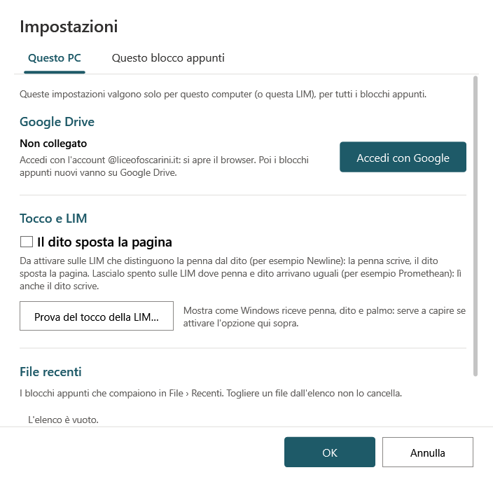

# Impostazioni

**File → Impostazioni…** apre una finestra con due schede: ciò che riguarda **questo PC** e ciò che riguarda **questo blocco appunti**.

## Questo PC

*«Queste impostazioni valgono solo per questo computer (o questa LIM), per tutti i blocchi appunti.»*

**Google Drive**

- **Accedi con Google** – collega Ardesia all'account della scuola (si apre il browser). Da collegati il riquadro dice «Collegato come …» e il pulsante diventa **Esci**. Vedi [Google Drive](Google-Drive.md#accedere-con-google).
- Lo spazio occupato su questo PC dalle copie dei blocchi su Drive e **Svuota la cache**.

**Tocco e LIM**

- **Il dito sposta la pagina** – la penna scrive, il dito fa scorrere la pagina (due dita: zoom). Da attivare **solo** sulle LIM che distinguono la penna dal dito (per esempio **Newline**); da lasciare spento dove penna e dito arrivano uguali (per esempio **Promethean**). Vedi [Uso sulle LIM](Uso-sulle-LIM.md). Lo stesso interruttore è in *Visualizza → Il dito sposta la pagina* e nella barra semplificata.
- **Prova del tocco della LIM…** – mostra come Windows riceve penna, dito e palmo, per capire se attivare l'opzione.

**File recenti**

- L'elenco dei blocchi che compaiono in *File → Recenti*. Si può togliere un file dall'elenco (**non lo cancella**) o **Svuota l'elenco**.

Sono «di questo PC» anche, senza bisogno di aprire le Impostazioni:

- le **penne** della barra (colori, spessori, matite);
- la misura della **gomma precisa**;
- la scelta fra barra **completa** e **semplificata**;
- l'**ultimo blocco** aperto (che si riapre all'avvio) e le ultime cartelle usate;
- l'**accesso a Google** (cifrato, in `%LocalAppData%\Ardesia`).

Tutto si trova nel file `%AppData%\Ardesia\settings.json` del tuo utente Windows. Su un PC dove entrano più docenti, ognuno con il suo utente, ognuno ha le sue impostazioni.

## Questo blocco appunti

*«Queste impostazioni sono salvate nel blocco appunti: valgono anche quando lo apri su un altro computer o su un'altra LIM.»*

Per ora c'è il **PDF per la classe**: attivo o spento, dove si scrive il file, quali sezioni includere, **Aggiorna ora il PDF** e, per i blocchi su Drive, **Copia il link per gli alunni** e **Apri il PDF su Drive**. Vedi [PDF per la classe](PDF.md#il-pdf-per-la-classe). Per un blocco su Drive la scheda dice anche in quale cartella di Drive si trova.

**OK** salva le modifiche, **Annulla** le lascia perdere.
