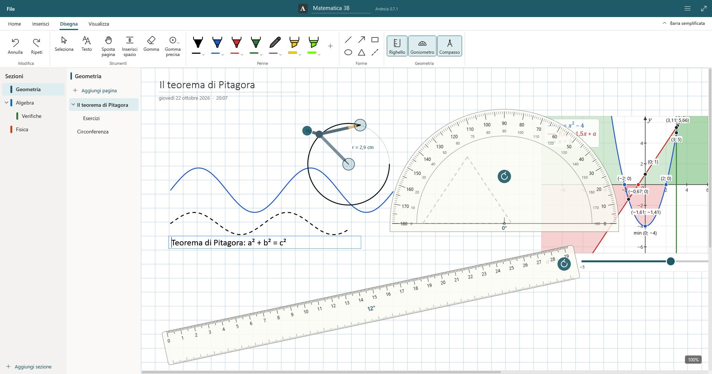
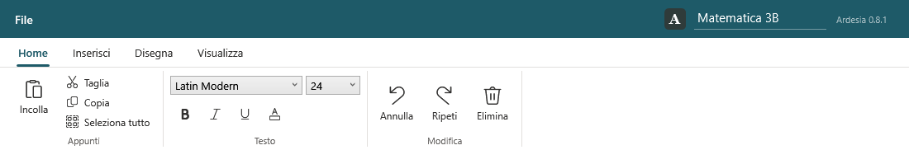
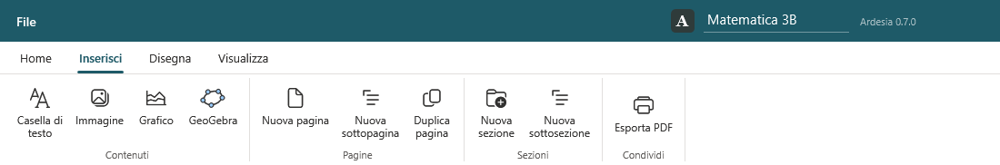
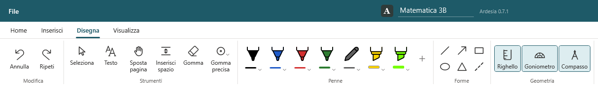
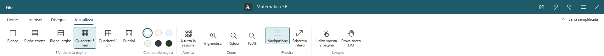

# La finestra e le barre degli strumenti

La finestra ha quattro parti:

1. **La barra colorata in alto** (color petrolio): a sinistra il menu **File**, al centro il **nome del blocco appunti**, a destra lo stato del salvataggio («Salvato alle 10:32») e i pulsanti **Salva**, **Annulla**, **Ripeti**, **☰ Mostra/nascondi sezioni e pagine** e **Schermo intero** (F11).
2. **La barra degli strumenti**, in due versioni: *completa* (a schede, come in Office) o *semplificata* (una riga sola).
3. Le colonne delle **sezioni** e delle **pagine** (nascondibili).
4. Il **foglio** della pagina, con lo zoom attuale in basso a destra («100%»).

## La barra completa

Ha quattro schede. All'avvio è aperta **Disegna**.

### Home

- **Appunti**: Incolla, Taglia, Copia, Seleziona tutto.
- **Testo**: tipo e dimensione del carattere, Grassetto, Corsivo, Sottolineato, Colore del testo (per le [caselle di testo](Testo-immagini-e-appunti.md)).
- **Modifica**: Annulla, Ripeti, Elimina.

### Inserisci

- **Contenuti**: Casella di testo, Immagine, **Grafico** (il [grafico di funzione di Ardesia](Grafico-di-funzione.md)), **GeoGebra** ([GeoGebra](GeoGebra.md)).
- **Pagine**: Nuova pagina, Nuova sottopagina, Duplica pagina.
- **Sezioni**: Nuova sezione, Nuova sottosezione.
- **Condividi**: Esporta PDF.

### Disegna

- **Strumenti**: Seleziona, Testo, Sposta pagina, Gomma, Gomma precisa.
- **Penne**: le tue penne, evidenziatori e matite, più il pulsante **+** per aggiungerne. Vedi [Scrivere e disegnare](Scrivere-e-disegnare.md).
- **Forme**: linea, freccia, rettangolo, ellisse, triangolo.
- **Geometria**: Righello, Goniometro, Compasso.

### Visualizza

- **Sfondo della pagina**: Bianco, Righe strette, Righe larghe, Quadretti 5 mm, Quadretti 1 cm, Puntini.
- **Colore della pagina**: bianco, avorio, azzurro chiaro, verde chiaro, Ardesia (scuro), Lavagna verde.
- **Applica**: «A tutta la sezione» (stesso sfondo per tutte le pagine della sezione).
- **Zoom**: Ingrandisci, Riduci, 100%.
- **Finestra**: Navigazione (mostra/nasconde sezioni e pagine), Schermo intero.
- **Lavagna**: **Il dito sposta la pagina** e **Prova tocco LIM** (vedi [Uso sulle LIM](Uso-sulle-LIM.md)).

## La barra semplificata

Con il pulsante **Barra semplificata** (in alto a destra della barra completa) gli strumenti si riducono a **una sola riga**, che lascia più spazio al foglio. Contiene, da sinistra:

Annulla, Ripeti · Seleziona, Testo, Sposta pagina, Il dito sposta la pagina · le penne (con il **+**) · Gomma, Gomma precisa · Forme (un pulsante che apre le cinque forme), Righello, Goniometro, Compasso · Inserisci immagine, **Grafico**, Nuova pagina, Esporta in PDF.

Il pulsante **Barra completa** (a destra) riporta le schede. La scelta resta memorizzata su quel PC.

> ⚠ Da verificare: aggiungere un'istantanea della barra semplificata.

Nella barra semplificata non ci sono GeoGebra, gli sfondi e i comandi del testo: per quelli si torna alla barra completa (GeoGebra si apre anche dal [menu contestuale](Testo-immagini-e-appunti.md#il-menu-contestuale) di una casella di testo).

## Schermo intero

**F11** (o il pulsante con le frecce in alto a destra, o *Visualizza → Schermo intero*) nasconde la barra delle applicazioni di Windows. **Esc** o di nuovo F11 per uscire.
