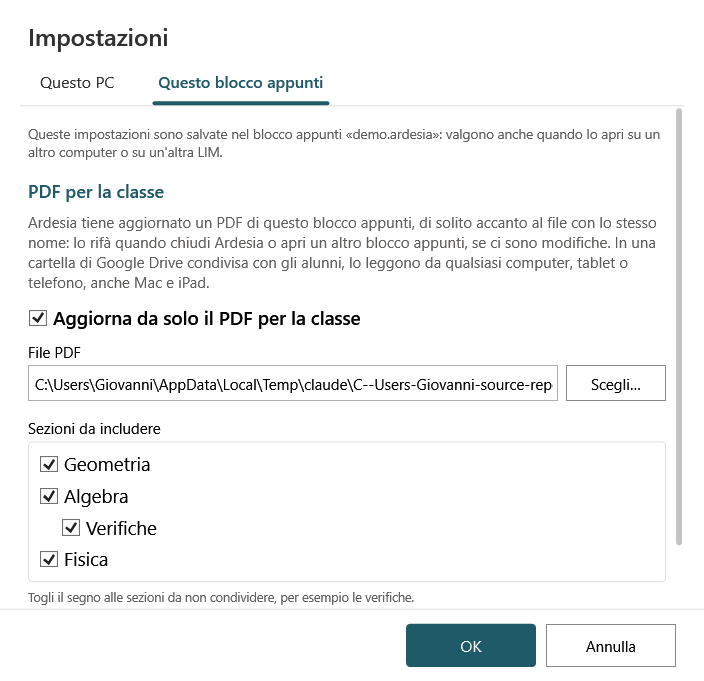

# PDF: esportazione e PDF per la classe

Gli alunni (e i colleghi) **non possono aprire i file `.ardesia`** senza Ardesia, e molti hanno Mac, iPad o telefoni. Per condividere gli appunti si usano i **PDF**, in due modi.

## Esportare in PDF

**File → Esporta in PDF…**, **Ctrl+P**, *Inserisci → Esporta PDF*, oppure il pulsante della barra semplificata. Si apre la finestra **«Cosa vuoi esportare?»**:

- **La pagina corrente**, con l'opzione **Includi le sottopagine**;
- **La sezione corrente, con le sottosezioni**;
- **L'intero blocco appunti**;
- **Apri il PDF al termine dell'esportazione** (spuntata di solito).

Premi **Esporta…** e scegli dove salvare. La finestra ricorda che, per condividere il PDF, conviene salvarlo in una cartella di **Google Drive** condivisa con la classe; se sul PC c'è *Google Drive per desktop*, Drive compare nella barra laterale della finestra di salvataggio.

Si esporta anche dal menu contestuale di una sezione (*Esporta la sezione in PDF…*) o di una pagina (*Esporta la pagina in PDF…*).

Il PDF contiene ogni pagina con il suo sfondo, i tratti, i testi, le immagini e i grafici (nitidi), e ha i **segnalibri** con sezioni e pagine. Righello, goniometro e compasso non compaiono.

## Il PDF per la classe

Il **PDF per la classe** è un PDF dell'intero blocco appunti che **Ardesia tiene aggiornato da sola**.

- È **attivo per ogni blocco appunti**, fin dalla creazione.
- Si trova **accanto al file `.ardesia`, con lo stesso nome**: `Matematica 3B.ardesia` → `Matematica 3B.pdf`. Per un blocco su Google Drive è accanto al blocco **su Drive** (vedi [sotto](#il-pdf-per-la-classe-su-google-drive)).
- Viene rifatto **quando chiudi Ardesia o apri un altro blocco appunti**, e solo **se ci sono state modifiche** (o se il PDF manca). Non a ogni salvataggio, per non rallentare la LIM durante la lezione.

**L'idea:** gli alunni leggono il PDF da qualsiasi dispositivo, mentre tu scrivi solo in Ardesia. Il modo più semplice è un [blocco su Google Drive](Google-Drive.md): Ardesia carica e condivide il PDF da sé e il link non cambia mai. In alternativa, con Drive per desktop, tieni il blocco in una cartella di `G:` condivisa con la classe (in sola lettura per gli alunni): Drive per desktop carica il PDF aggiornato quando chiudi Ardesia.

### Il PDF per la classe su Google Drive

Per un blocco salvato su Drive da Ardesia:

- il PDF va **nella stessa cartella del blocco su Drive**, con lo stesso nome, e si aggiorna **sempre nello stesso file**: **il link non cambia mai**, basta incollarlo una volta su Classroom;
- Ardesia lo **condivide con la scuola**: lo apre chi ha il link e un account @liceofoscarini.it (gli alunni, anche da casa);
- nelle impostazioni del PDF compaiono **Copia il link per gli alunni**, **Apri il PDF su Drive** e l'ora dell'ultimo aggiornamento su Drive;
- rinominando il blocco si rinomina anche il PDF; spegnendo il PDF per la classe, quello già su Drive resta (con il suo link) ma non si aggiorna più.

Se Google non permette ad Ardesia di condividerlo (lo decide l'amministratore della scuola), Ardesia lo scrive nelle impostazioni del PDF e spiega come condividerlo a mano; poi c'è **Riprova a condividere**. Vedi [Google Drive](Google-Drive.md#il-pdf-per-la-classe-su-drive).

### Impostazioni del PDF per la classe

Da **File → PDF per la classe…** (oppure *File → Impostazioni… → Questo blocco appunti*):

- **Aggiorna da solo il PDF per la classe** – togli la spunta per spegnerlo per questo blocco (il menu File mostra allora «PDF per la classe (spento)…»).
- **File PDF** – dove scriverlo; **Scegli…** per metterlo altrove (per esempio in un'altra cartella condivisa). Per i blocchi su Drive non c'è: il PDF sta accanto al blocco su Drive.
- **Copia il link per gli alunni**, **Apri il PDF su Drive**, **Riprova a condividere** – solo per i blocchi su Drive (vedi sopra).
- **Sezioni da includere** – **togli il segno alle sezioni da non condividere**, per esempio le *Verifiche*.
- **Aggiorna ora** / **Aggiorna ora il PDF** – lo rifà subito, senza aspettare la chiusura.

Queste impostazioni sono salvate **nel blocco appunti**: valgono anche quando lo apri su un altro PC o su un'altra LIM.

### Se il PDF non si aggiorna

- Nella barra in alto compare per esempio «PDF per la classe non aggiornato: cartella non trovata». Se la cartella è su `G:`, controlla che **Google Drive per desktop** sia avviato.
- Per un blocco su Drive, se manca la rete il PDF viene rifatto sul PC e caricato appena la rete torna; nelle impostazioni del PDF compare «PDF rifatto su questo PC: Ardesia lo carica su Google Drive appena può».
- Se all'uscita il PDF non si può scrivere (per esempio è aperto in un altro programma), Ardesia avvisa e chiede se **uscire lo stesso** o **restare** (poi *File → PDF per la classe… → Aggiorna ora*).
- Il PDF si scrive prima in un file temporaneo: se qualcosa va storto, il PDF precedente resta intatto.
