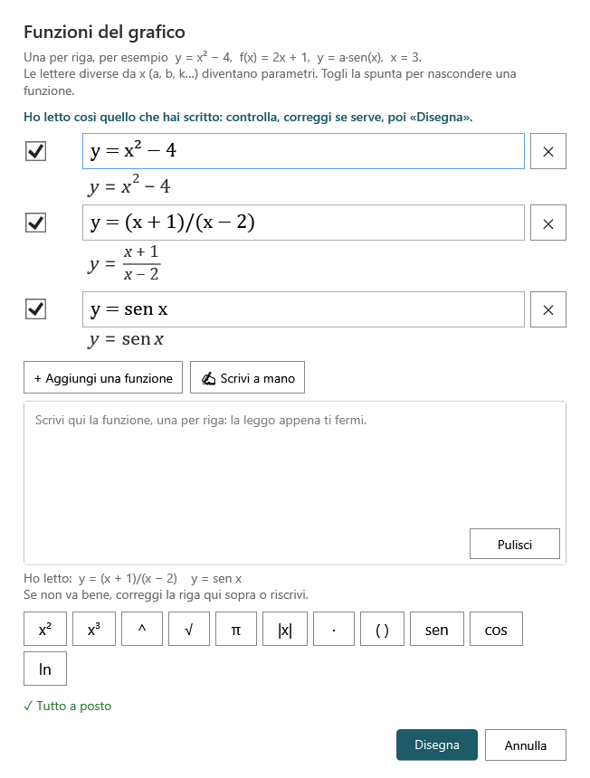

# Scrivere a mano le funzioni

Alla LIM è naturale **scrivere la funzione con la penna**, come alla lavagna. Ardesia la fa leggere al **riconoscimento delle formule di Windows** e la trasforma in grafico. Prima di disegnare **mostra sempre che cosa ha letto**, così puoi correggere.

## Sul foglio: scrivi, circonda, «Grafico»

1. Scrivi la funzione sul foglio con una penna, per esempio `y = x² − 4`. Più funzioni vanno **una sotto l'altra**, ben separate.
2. Prendi lo strumento **Seleziona** e **circonda** con il lazo ciò che hai scritto.
3. Premi **Grafico** (scheda *Inserisci* o barra semplificata), oppure, dal menu contestuale (pressione prolungata sulla scrittura), **Disegna il grafico della funzione scritta**.
4. Dopo un attimo (circa un secondo o due per riga) si apre la finestrella **Funzioni del grafico** con l'avviso *«Ho letto così quello che hai scritto: controlla, correggi se serve, poi «Disegna».»* e una riga per ogni funzione letta, con sotto la formula composta.
5. Controlla: se qualcosa non va, correggilo con la tastiera, oppure riscrivilo con **✍ Scrivi a mano** (sotto).
6. Premi **Disegna**: il grafico compare **accanto alla scrittura**, che resta sul foglio com'era.

Se Ardesia non riesce a leggere nulla, la finestrella lo dice e puoi scrivere la funzione con la tastiera o con *Scrivi a mano*.

## Nella finestrella: «✍ Scrivi a mano»

Nella finestrella **Funzioni del grafico** (che si apre anche con un doppio clic su un grafico) il pulsante **✍ Scrivi a mano** apre una **striscia bianca**: *«Scrivi qui la funzione, una per riga: la leggo appena ti fermi.»*

- Scrivi la funzione; **circa un secondo dopo** che hai alzato la penna, Ardesia la legge.
- Ciò che ha letto va nelle **righe vuote** della finestrella (o in righe nuove) e la scrittura sparisce dalla striscia. Sotto la striscia compare «Ho letto: …».
- **Pulisci** cancella la striscia per riscrivere.
- Così si aggiunge una funzione a un grafico che c'è già, o si corregge una riga letta male.

## Consigli per farsi leggere bene

- Scrivi **abbastanza grande** e con calma; gli esponenti chiaramente più in alto e più piccoli.
- **Una funzione per riga**, con un po' di spazio fra le righe. Le frazioni con la linea orizzontale vanno bene: numeratore e denominatore restano insieme.
- Il riconoscitore conosce `sin`/`tan` all'inglese: Ardesia corregge da sola i casi più comuni (`sen`, `tg`), ma **controlla sempre** le funzioni goniometriche e le **lettere isolate** dei parametri (`a`, `b`, `k`), che sono le più facili da sbagliare.
- Il riconoscitore propone **una sola lettura**: se è sbagliata, correggi con la tastiera o riscrivi.

## Se il pulsante è spento

Il riconoscimento usa un componente di Windows (il vecchio «Pannello di input matematico»). Se su un PC manca, il pulsante *✍ Scrivi a mano* è grigio e spiega: *«Su questo PC Windows non ha il riconoscimento delle formule scritte a mano: scrivi la funzione con la tastiera.»* Tutto il resto del grafico funziona normalmente.

> ⚠ Da verificare sui PC delle LIM (Promethean e Newline/OPS) se il componente c'è, e provare la scrittura vera col dito e con la penna delle due lavagne.
